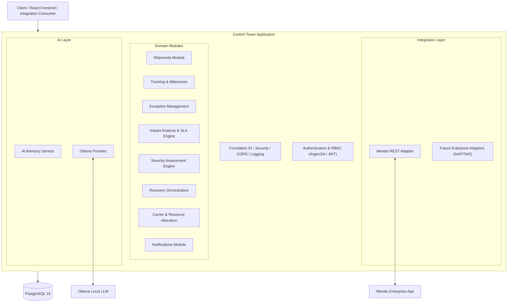

# Architecture Documentation

## Architectural Principles

The Shipment Exception Control Tower is implemented as a **Modular Monolith**.

### 1. Module Independence & Encapsulation
- Each domain module (e.g., `shipments`, `exceptions`, `recovery`, `carriers`) owns its business logic, database models, repositories, and API endpoints.
- Cross-module communication occurs strictly via explicit **Service Interfaces**. Direct access to another module's repositories, internal database tables, or private functions is prohibited.
- Modules are designed so they can be extracted into microservices in the future with minimal refactoring.

### 2. Integration Adapter Pattern
- External systems (Mendix, SAP, TMS, GPS providers) are isolated behind dedicated adapter modules in `integrations/`.
- No direct database connections to external systems (such as Mendix) are allowed. All communication happens through versioned REST APIs.
- Core business logic remains entirely agnostic of external system schemas. Adapters transform external payloads into internal domain models.

### 3. Decoupled AI Provider Architecture
- The AI subsystem (`ai/`) is accessed through a standardized provider abstraction (`ai/providers/base.py`).
- AI capabilities (summarization, root-cause analysis, recovery advisory) produce structured Pydantic models.
- **Operational Safety Rule:** AI outputs are purely advisory. AI never directly triggers recovery actions or overrides deterministic business rules for ETAs, SLAs, or severity classifications.

### 4. Security & Zero-Trust Authentication
- Access tokens are short-lived (10–15 min) JWTs stored in client memory.
- Refresh tokens are cryptographically random opaque strings stored as hashes in PostgreSQL, transmitted via `HttpOnly`, `Secure`, `SameSite` cookies with rotation and reuse detection.
- Passwords are hashed with **Argon2id**.
- Role-Based Access Control (RBAC) governs both endpoint access and business-level data scoping.

### 5. High-Level Component Architecture

