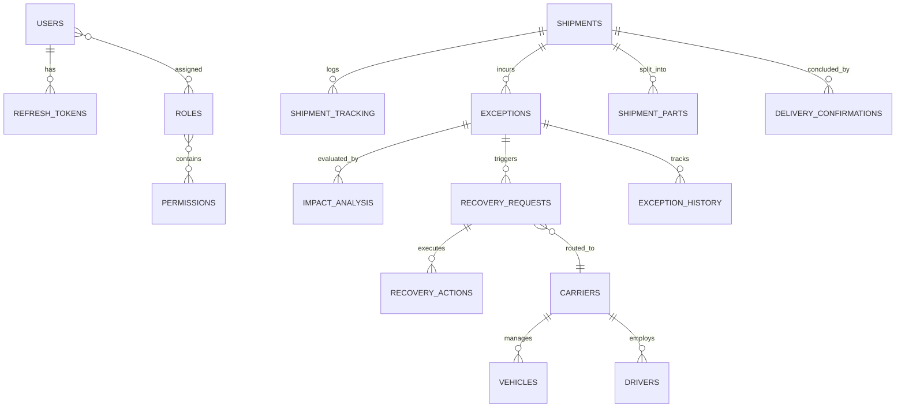

# Database Design

## Overview
The application uses **PostgreSQL** with **SQLAlchemy 2.x** and **Alembic** for schema migrations.

## Core Rules & Conventions
1. **Primary Keys:** UUID v4 for business entities to prevent enumeration attacks and support distributed generation.
2. **Timestamps:** Timezone-aware UTC timestamps (`created_at`, `updated_at`) on all persistent records.
3. **Foreign Keys & Indices:** Explicit foreign keys with appropriate cascading rules and indexes on lookup columns (e.g., `shipment_id`, `status`, `tracking_number`).
4. **Audit History:** Critical state changes (exceptions, recovery decisions, dispatch updates) maintain historical log tables.
5. **Domain Separation:** Each module owns its tables. Cross-module data integrity is managed at the service and transaction boundary layer.

## Base Mixins & ORM Specification (`app/database/base.py`)
- **`Base`**: Root `DeclarativeBase` generating lowercased table names by default with `.to_dict()` helper.
- **`UUIDPrimaryKeyMixin`**: Defines `id: Mapped[uuid.UUID]` with default `uuid.uuid4`, primary key, and indexed.
- **`TimestampMixin`**: Defines `created_at` and `updated_at` as timezone-aware `DateTime(timezone=True)` using UTC timestamps.

## Database Connection & Session Lifecycle (`app/database/connection.py`)
- Asynchronous SQLAlchemy 2.x engine initialized with `postgresql+asyncpg://`.
- Connection pooling with `pool_size`, `max_overflow`, `pool_timeout`, and `pool_pre_ping=True`.
- `get_db_session()` FastAPI dependency: commits transaction on success, rolls back on exception, and closes session on completion.
- `check_database_health()` executes lightweight `SELECT 1` with transaction rollback to continuously verify connectivity for container orchestrators.

## Migrations Engine (`app/database/migrations/`)
- Alembic configured for async migrations via `async_engine_from_config` in `app/database/migrations/env.py`.
- Migration templates output formatted revisions in UTC (`YYYYMMDD_HHMM_<rev>_<slug>.py`).

## Domain Entity Map

*Detailed entity specifications and Alembic migrations will be generated systematically during Phase 2 and subsequent domain phases.*
