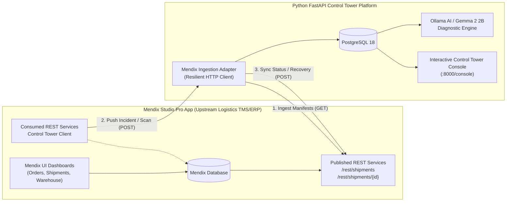
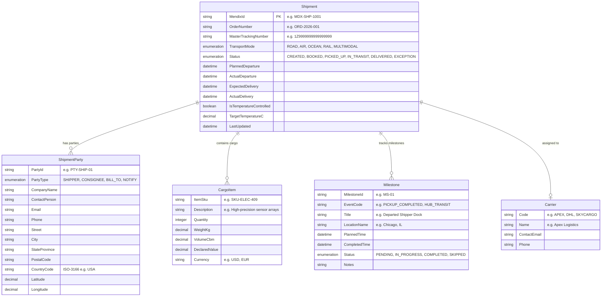

# Mendix Application Implementation & Integration Guide
## Enterprise Shipment Exception Control Tower Integration Architecture

---

## 1. Executive Summary & Architecture Overview

The **Control Tower Platform** is designed to ingest shipment manifests, track operational milestones, monitor cold-chain telematics, and orchestrate automated exception resolution.

While the Control Tower contains an internal mock sandbox (`/api/v1/mock/mendix`) for isolated local development, this guide outlines the **step-by-step implementation flow to build, configure, and connect a dedicated low-code Mendix application** as the upstream master system.



---

## 2. Integration Modes & Touchpoints

The integration consists of two core directions:

1. **Pull Ingestion (Control Tower $\rightarrow$ Mendix):**
   - Control Tower calls Mendix REST endpoint `GET /rest/shipments/{external_id}` to synchronize single shipments.
   - Control Tower calls `GET /rest/shipments?updatedSince={iso}&limit={n}` for batch synchronization.
2. **Push Notifications & Exceptions (Mendix $\rightarrow$ Control Tower):**
   - When a dispatcher or warehouse operator in Mendix logs an operational disruption, Mendix microflow calls Control Tower REST endpoint `POST /api/v1/exceptions`.
   - Milestone events and tracking scans can be published to `POST /api/v1/tracking/events`.

---

## 3. Mendix Domain Model Specification

In **Mendix Studio Pro**, create a new module named `ShipmentIntegration` (or extend your existing `Logistics` module). Configure the following entities and associations:



---

## 4. JSON Payload Schemas (Strict Canonical Alignment)

To communicate seamlessly with the Control Tower adapter, your Mendix **JSON Export Mappings** must strictly produce the following structure.

### 4.1. Single Shipment Response Schema (`GET /rest/shipments/{mendixId}`)

```json
{
  "mendixId": "MDX-SHP-1001",
  "orderNumber": "ORD-2026-001",
  "trackingNumber": "1Z9999999999999999",
  "statusCode": "IN_TRANSIT",
  "transportType": "ROAD",
  "carrier": {
    "code": "APEX",
    "name": "Apex Logistics"
  },
  "shipper": {
    "partyId": "PTY-SHIP-01",
    "companyName": "Acme Industrial Corp",
    "contactPerson": "Alice Brown",
    "phone": "+1-555-1234",
    "email": "shipping@acmeindustrial.com",
    "address": {
      "street": "100 Factory Lane",
      "city": "Chicago",
      "state": "IL",
      "postalCode": "60601",
      "countryCode": "USA",
      "lat": 41.8781,
      "lng": -87.6298
    }
  },
  "consignee": {
    "partyId": "PTY-CONS-01",
    "companyName": "Global Retail Warehouse",
    "contactPerson": "Bob Johnson",
    "phone": "+1-555-5678",
    "email": "receiving@globalretail.com",
    "address": {
      "street": "500 Distribution Blvd",
      "city": "Dallas",
      "state": "TX",
      "postalCode": "75201",
      "countryCode": "USA",
      "lat": 32.7767,
      "lng": -96.7970
    }
  },
  "cargoItems": [
    {
      "itemSku": "SKU-ELEC-409",
      "itemDescription": "High-precision sensor arrays",
      "quantity": 20,
      "weightKg": 450.5,
      "volumeCbm": 2.8,
      "declaredValue": 85000.00,
      "currency": "USD"
    }
  ],
  "milestones": [
    {
      "id": "MS-01",
      "code": "PICKUP_COMPLETED",
      "description": "Departed Shipper Dock",
      "location": "Chicago, IL",
      "targetTime": "2026-11-19T06:00:00Z",
      "completedTime": "2026-11-19T06:15:00Z",
      "status": "COMPLETED",
      "notes": "Driver checked in on time"
    },
    {
      "id": "MS-02",
      "code": "HUB_TRANSIT",
      "description": "Arrived Transit Hub",
      "location": "St. Louis, MO",
      "targetTime": "2026-11-19T14:00:00Z",
      "completedTime": null,
      "status": "IN_PROGRESS",
      "notes": null
    }
  ],
  "plannedDeparture": "2026-11-19T06:00:00Z",
  "actualDeparture": "2026-11-19T06:15:00Z",
  "expectedDelivery": "2026-11-20T18:00:00Z",
  "actualDelivery": null,
  "customAttributes": {
    "priority": "HIGH",
    "temperatureControlled": false
  }
}
```

### 4.2. Batch Updated Shipments Schema (`GET /rest/shipments?updatedSince=...`)

```json
{
  "totalCount": 2,
  "items": [
    {
      "mendixId": "MDX-SHP-1001",
      "...": "same object as above"
    }
  ]
}
```

---

## 5. Step-by-Step Implementation in Mendix Studio Pro

### Step 5.1: Create Module Constants & Authentication
1. In Mendix Studio Pro Project Explorer, open `ShipmentIntegration`.
2. Add a **Constant** named `ApiKey_Expected`:
   - Type: `String`
   - Default value: `mendix-test-api-key` (or your chosen secure production key).
3. Add a **Microflow** named `MF_ValidateApiKey`:
   - Input Parameter: `ApiKeyHeader` (String).
   - Logic: Compare `$ApiKeyHeader = @ShipmentIntegration.ApiKey_Expected`.
   - Return: `Boolean`.

### Step 5.2: Create JSON Structure & Export Mappings
1. Right-click the module $\rightarrow$ **Add Other** $\rightarrow$ **JSON Structure**.
   - Name: `JSON_ShipmentPayload`.
   - Paste the sample JSON from Section 4.1 above.
2. Right-click $\rightarrow$ **Add Other** $\rightarrow$ **Export Mapping**.
   - Name: `Export_Shipment`.
   - Select schema source: `JSON_ShipmentPayload`.
   - Map domain model entities (`Shipment`, `Carrier`, `ShipmentParty`, `CargoItem`, `Milestone`) to JSON properties.

### Step 5.3: Publish REST Service (Exposing APIs to Control Tower)
1. Right-click $\rightarrow$ **Add Other** $\rightarrow$ **Published REST Service**.
   - Name: `PRS_ShipmentService`.
   - Version: `v1`.
   - Service name: `rest`.
2. **Configure Security:**
   - On the **Security** tab, select **Authentication microflow** $\rightarrow$ select `MF_ValidateApiKey` inspecting HTTP header `X-API-Key`.
3. **Add Resource: `/shipments/{id}`:**
   - Path: `/shipments/{id}`
   - Operation: `GET`
   - Microflow: `MF_PRS_GetShipmentById`
     - Extract path parameter `id`.
     - Retrieve `Shipment` from database where `MendixId = $id`.
     - If `$Shipment = empty`, return `404 Not Found`.
     - Apply Export Mapping `Export_Shipment`.
     - Return HTTP `200 OK` with JSON string content.
4. **Add Resource: `/shipments`:**
   - Path: `/shipments`
   - Operation: `GET`
   - Query Parameters: `updatedSince` (DateTime, optional), `limit` (Integer, default 50).
   - Microflow: `MF_PRS_GetShipmentsBatch`
     - Retrieve list of `Shipment` where `LastUpdated >= $updatedSince` (limit `$limit`).
     - Return HTTP `200 OK` with JSON array.

### Step 5.4: Consume Control Tower APIs (Pushing Events from Mendix)
When an exception or scan occurs in Mendix (e.g. user clicks "Report Delay" on a Mendix dashboard):
1. Create a Constant in Mendix: `ControlTower_BaseUrl` = `http://localhost:8000/api/v1`.
2. Create a Microflow: `MF_PushExceptionToControlTower`:
   - Call REST Service:
     - Method: `POST`
     - URL: `@ShipmentIntegration.ControlTower_BaseUrl + '/exceptions'`
     - Headers:
       - `Content-Type: application/json`
       - `Authorization: Bearer <Admin_JWT_Token>`
     - Request Body:
       ```json
       {
         "shipment_id": "$Shipment/ControlTowerUUID",
         "exception_type": "DELAY",
         "severity": "HIGH",
         "title": "Severe Highway Traffic Backlog",
         "description": "$ExceptionDetails/UserNotes"
       }
       ```

---

## 6. Switching Control Tower from Sandbox to Live Mendix

Once your Mendix app is running locally (e.g. at `http://localhost:8080/rest`):

1. Open `.env` in the Control Tower repository root:
   ```env
   # External Integrations - Mendix
   MENDIX_BASE_URL=http://localhost:8080/rest
   MENDIX_API_KEY=your-mendix-secure-key
   MENDIX_TIMEOUT_SECONDS=10
   MENDIX_MAX_RETRIES=3
   ```
2. Restart the Control Tower application:
   ```powershell
   python -m uvicorn app.main:app --host 127.0.0.1 --port 8000
   ```
3. Open [http://127.0.0.1:8000/console](http://127.0.0.1:8000/console) $\rightarrow$ Navigate to **Shipments & Ingestion** $\rightarrow$ Click **"Sync MDX-SHP-1001"** or **"Batch Sync Mendix"**. The Control Tower will now ingest live manifests directly from your Mendix database.

---

## 7. Integration Verification Checklist

| # | Checkpoint | Verification Method |
|---|---|---|
| 1 | Mendix Published Service Listening | Open `http://localhost:8080/rest/doc/` to see Mendix Swagger doc |
| 2 | Header Authentication Enforcement | Call without `X-API-Key` $\rightarrow$ Expect `401 Unauthorized` |
| 3 | Single Shipment Query | Call `GET /rest/shipments/MDX-SHP-1001` with header $\rightarrow$ Expect `200 OK` with valid JSON |
| 4 | Batch Query with Filter | Call `GET /rest/shipments?updatedSince=2026-01-01T00:00:00Z&limit=10` $\rightarrow$ Expect `200 OK` |
| 5 | Control Tower Ingestion | Click **Sync MDX-SHP-1001** on Control Tower console $\rightarrow$ Check green toast notification |
